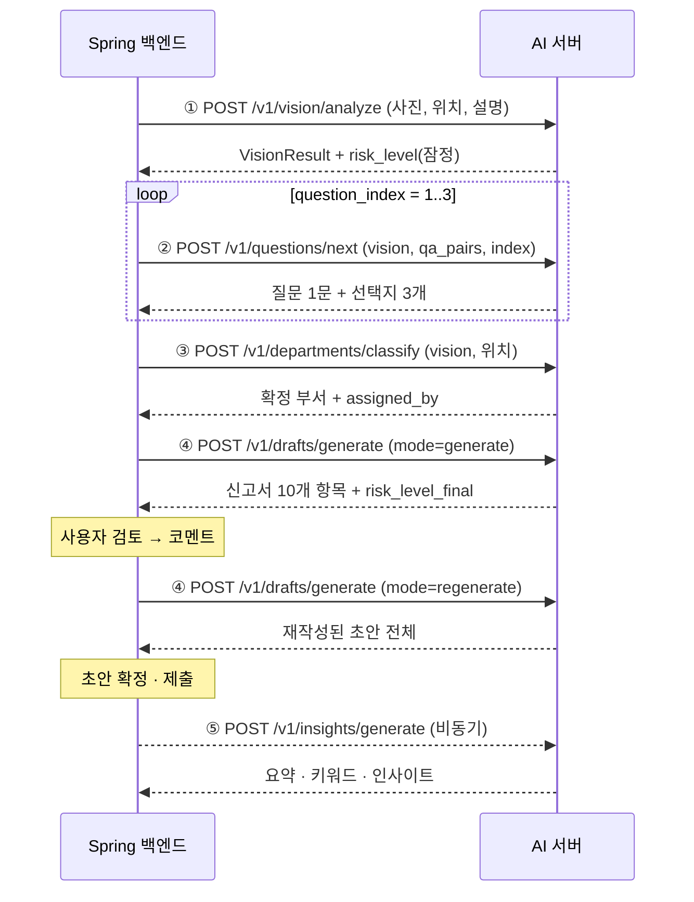

# 안전고래 AI 서버 — API 명세서 (v0.1, 프로토타입)

> `노드별설명.md` 의 Dify 5개 앱을 REST 엔드포인트 5개로 옮긴 것이다.
> 프롬프트·구조화 출력 스키마는 문서의 값을 그대로 쓴다. 이 명세서와 코드가 어긋나면 코드가 맞다.
> 호출 주체는 **Spring 백엔드**다. 프론트는 AI 서버를 직접 호출하지 않는다.

## 0. 공통 규칙

- **Base URL**: 로컬 `http://127.0.0.1:8000` (컨테이너 배포 시 서비스명:8000)
- **Content-Type**: `application/json` (요청·응답 모두)
- **응답 포맷**: Spring 의 `{success, data, error}` 래퍼를 쓰지 않는다. **성공 시 결과 객체를 그대로** 반환한다.
  AI 서버는 내부 서비스이고, Spring 이 이 응답을 검증해 자신의 래퍼에 실어 프론트로 내보낸다.
- **인증**: **아직 없음.** Dify 시절 `X-Agent-Token` 을 AI 서버가 검증하도록 붙여야 한다 (7. 남은 것).
- **무상태**: 5개 API 모두 세션을 들고 있지 않다. `session_id` 는 로그 상관관계 추적용이며,
  대화 맥락은 **호출자(Spring)가 `vision` / `qa_pairs` 로 매번 넘긴다.**
- **멱등성 없음**: 같은 `session_id` 로 두 번 부르면 LLM 이 두 번 호출된다. 중복 방지는 백엔드 몫.
- **`snake_case`**: 요청·응답 필드는 전부 스네이크케이스다 (Dify 변수명을 그대로 유지).

### 공통 객체

#### `VisionResult` — ① 의 판독 결과. ②③④ 가 입력으로 받는다

```json
{
  "detected_hazard": "바닥 타일 파손 및 돌출",
  "photo_analysis": "복도 바닥 타일 일부가 파손되어 파편이 발생하였으며, 파손된 타일 조각이 바닥면 위로 돌출되어 있음.",
  "risk": "보행자가 파손된 타일 부위에 발이 걸려 넘어질 경우, 신체 전도로 인한 타박상이나 골절 등의 부상이 발생할 수 있음.",
  "exposed_target": "김대건관 3층 서편 복도를 이용하는 학생 및 교직원"
}
```

`risk_level` 은 여기 포함되지 않는다. ④ 가 별도 필드(`risk_level`)로 받아 재산출한다.

#### `PhotoInput` — ① 전용. `url` 또는 `base64` 중 **하나는 필수**

| 필드 | 타입 | 설명 |
|---|---|---|
| `url` | string | 백엔드 A-4 signed URL. 로컬 파일 경로와 `data:` URI 도 받는다 (실험용) |
| `base64` | string | base64 인코딩된 이미지 바이트 |
| `mime_type` | string | `base64` 사용 시. 기본 `image/jpeg` |

운영에서는 `url`(signed URL)만 쓴다. `base64` 는 로컬 실험 편의용이다.

#### `QaPair`

```json
{ "question": "언제 처음 발견하셨나요?", "answer": "오늘 처음 발견했습니다" }
```

#### `risk_level` enum

`low` | `medium` | `high` | `critical`

| 값 | 기준 |
|---|---|
| `critical` | 즉시 인명 사고로 이어질 수 있음 |
| `high` | 중상 가능성이 있음 |
| `medium` | 경상·전도 등 부상 가능성이 있음 |
| `low` | 즉각적 위험은 낮으나 개선이 필요함 |

## 1. 엔드포인트 목록

| Method | Path | 원본 Dify 앱 | 호출 시점 | 실측 지연 |
|---|---|---|---|---|
| POST | `/v1/vision/analyze` | ① 사진 판독 | 사진 업로드 직후 1회 | ~7s |
| POST | `/v1/vision/analyze-upload` | ① 사진 판독 (파일 업로드 판) | **개발/시험용** | ~7s |
| POST | `/v1/questions/next` | ② 확인 질문 생성 | `question_index` 1·2·3 으로 **3회** | ~1.5s |
| POST | `/v1/departments/classify` | ③ 담당 부서 판정 | 질의응답 완료 후 1회 | ~1.3s |
| POST | `/v1/drafts/generate` | ④ 신고서 초안 생성 | 신규 1회 + 재생성 N회 | ~3.5s |
| POST | `/v1/insights/generate` | ⑤ 요약·인사이트 | 초안 확정 후 **비동기** 1회 | ~3.2s |
| GET | `/health` | — | 헬스체크 | 즉시 |

`GET /docs` 에 Swagger UI 가 떠 있다.

### 호출 순서



③ 은 ② 와 독립이다 (`vision` 만 있으면 된다). 지연을 줄이려면 ② 질문 루프와 병렬로 돌려도 된다.

---

## 2. ① 사진 판독 — `POST /v1/vision/analyze`

현장 사진 1장 + 부연 설명 + 신고 위치를 받아 위험 요소를 판독한다.
**비전 입력이 켜진 유일한 엔드포인트다.**

모델 `gemini-3.1-flash-lite` · temperature `0.2`

### 요청

| 필드 | 타입 | 필수 | 설명 |
|---|---|---|---|
| `session_id` | string | ✅ | 로그 상관관계 추적용 |
| `location_text` | string | ✅ | 신고 위치 (백엔드 location.parse 정규화 결과) |
| `description` | string | ✅ | 제보자 부연 설명 |
| `photo` | `PhotoInput` | ✅ | 현장 사진 1장 |

```json
{
  "session_id": "rpt-1042",
  "location_text": "김대건관 3층 서편 복도 (강의실 K308 앞)",
  "description": "복도 바닥 타일이 깨져서 위험해 보여요. 지나다닐 때마다 걸려서 넘어질 뻔했어요.",
  "photo": { "url": "https://s3.../signed/photo.jpg" }
}
```

### 응답 `200`

| 필드 | 타입 | 설명 |
|---|---|---|
| `detected_hazard` | string | 감지된 위험 요소 (짧은 명사구) |
| `photo_analysis` | string | 사진에서 관찰되는 상태 |
| `risk` | string | 위험성 (인과관계 서술) |
| `exposed_target` | string | 위험에 노출될 수 있는 대상 |
| `risk_level` | enum | **잠정** 위험 등급. ④ 가 질의응답을 반영해 재산출한다 |

```json
{
  "detected_hazard": "바닥 타일 파손 및 돌출",
  "photo_analysis": "복도 바닥 타일 일부가 파손되어 파편이 발생하였으며, 파손된 타일 조각이 바닥면 위로 돌출되어 있음.",
  "risk": "보행자가 파손된 타일 부위에 발이 걸려 넘어질 경우, 신체 전도로 인한 타박상이나 골절 등의 부상이 발생할 수 있음.",
  "exposed_target": "김대건관 3층 서편 복도를 이용하는 학생 및 교직원",
  "risk_level": "medium"
}
```

> **백엔드 주의**: `risk_level` 은 여기서 확정이 아니다. DB 에 저장할 최종 등급은
> ④ 의 `risk_level_final` 이다. ① 의 값은 잠정치로만 들고 있을 것.

### 2-1. 파일 업로드 판 — `POST /v1/vision/analyze-upload`

Swagger UI(`/docs`)에서 **로컬 사진을 바로 골라** 시험하기 위한 경로다.
`multipart/form-data` 로 받는다는 것만 다르고, 판독 로직과 응답 스키마는 위와 완전히 동일하다.
운영 연동은 `photo.url`(signed URL)을 쓰는 `POST /v1/vision/analyze` 로 한다.

| 파트 | 타입 | 필수 | 설명 |
|---|---|---|---|
| `file` | file | ✅ | 현장 사진 1장. `image/*` 만 허용, **10MB 이하** |
| `location_text` | string(form) | — | 신고 위치. 기본값 있음 |
| `description` | string(form) | — | 제보자 부연 설명. 기본 `""` |
| `session_id` | string(form) | — | 비우면 `docs-xxxxxxxx` 로 자동 생성 |

```bash
curl -X POST http://127.0.0.1:8000/v1/vision/analyze-upload   -F "file=@./현장.jpg"   -F "location_text=김대건관 3층 서편 복도"   -F "description=복도 바닥 타일이 깨져서 위험해 보여요."
```

| 오류 | 상황 |
|---|---|
| `415` | 이미지가 아닌 파일 |
| `413` | 10MB 초과 |
| `400` | 빈 파일 |

---

## 3. ② 확인 질문 생성 — `POST /v1/questions/next`

판독 결과와 직전 답변을 보고 확인 질문 1문 + 선택지 3개를 만든다.
**한 번에 질문 1개만 만든다.** 백엔드가 `question_index` 를 1·2·3 으로 바꿔가며 3회 호출한다.

모델 `gemini-3.1-flash-lite` · temperature `0.7`

### 요청

| 필드 | 타입 | 필수 | 설명 |
|---|---|---|---|
| `session_id` | string | ✅ | |
| `location_text` | string | ✅ | 신고 위치 |
| `description` | string | ✅ | 제보자 부연 설명 |
| `vision` | `VisionResult` | ✅ | ① 의 판독 결과 |
| `qa_history` | string | — | 정리된 질의응답 텍스트. 없으면 `(아직 없음)` 으로 채운다 |
| `qa_pairs` | `QaPair[]` | — | `qa_history` 대신 쓸 구조체. **둘 다 오면 `qa_history` 우선** |
| `question_index` | int (≥1) | ✅ | 이번 질문 번호 |
| `question_count` | int (≥1) | — | 총 질문 수. 기본 `3` |

```json
{
  "session_id": "rpt-1042",
  "location_text": "김대건관 3층 서편 복도 (강의실 K308 앞)",
  "description": "복도 바닥 타일이 깨져서 위험해 보여요.",
  "vision": {
    "detected_hazard": "바닥 타일 파손 및 돌출",
    "photo_analysis": "복도 바닥 타일 일부가 파손되어 파편이 발생함.",
    "risk": "보행자가 발이 걸려 넘어질 수 있음.",
    "exposed_target": "복도를 이용하는 학생 및 교직원"
  },
  "qa_pairs": [
    { "question": "언제 처음 발견하셨나요?", "answer": "오늘 처음 발견했습니다" }
  ],
  "question_index": 2,
  "question_count": 3
}
```

### 응답 `200`

| 필드 | 타입 | 설명 |
|---|---|---|
| `text` | string | 제보자에게 던질 질문 한 문장 (존댓말) |
| `options` | `{value, label}[]` | **정확히 3개**. `value` 는 스네이크케이스 식별자, `label` 은 한국어 문장 |

```json
{
  "text": "현재 해당 구역에 통행을 제한하거나 안내판을 설치하는 등 임시 조치가 되어 있나요?",
  "options": [
    { "value": "no_measures",      "label": "아무런 조치가 되어 있지 않습니다" },
    { "value": "partial_measures", "label": "안내판이나 테이프로 일부 막아두었습니다" },
    { "value": "unsure",           "label": "잘 모르겠습니다" }
  ]
}
```

> **`options` 는 항상 3개가 보장된다.** 모델이 2개나 4개를 줘도 서버가 보정한다
> (중복 `value` 제거 → 3개 초과분 절단 → 모자라면 `잘 모르겠어요` 로 채움).
> Dify code 노드 `1802000003` 을 그대로 옮긴 것이다.
>
> **"직접 입력" 은 `options` 에 들어가지 않는다.** 프론트가 네 번째 선택지로 붙인다
> (기존 Mock 계약의 `allowCustom=true` 와 같은 취급).

---

## 4. ③ 담당 부서 판정 — `POST /v1/departments/classify`

백엔드 RAG(C-1)로 업무범위를 검색해 LLM 이 부서를 고르고, C-2 로 코드 유효성·임계값 fallback 까지 확정한다.
**Dify 지식베이스는 쓰지 않는다** — 코퍼스를 백엔드 한 곳에서만 관리하기 위해서다.

모델 `gemini-3.1-flash-lite` · temperature `0.2`

### 요청

| 필드 | 타입 | 필수 | 설명 |
|---|---|---|---|
| `session_id` | string | ✅ | |
| `location_text` | string | ✅ | 신고 위치 |
| `vision` | `VisionResult` | ✅ | ① 의 판독 결과 |
| `top_k` | int | — | 업무범위 검색 개수. 비우면 `8` |

```json
{
  "session_id": "rpt-1042",
  "location_text": "김대건관 3층 서편 복도 (강의실 K308 앞)",
  "vision": { "detected_hazard": "...", "photo_analysis": "...", "risk": "...", "exposed_target": "..." }
}
```

### 응답 `200`

| 필드 | 타입 | 설명 |
|---|---|---|
| `department_code` | string | **확정된** 부서 코드 (C-2 통과) |
| `department_name` | string | 부서명 |
| `department_contact` | string | 연락처. 없으면 `""` |
| `assigned_by` | string | `agent` = LLM 판정 채택 / `fallback` = 기본 부서로 강등 |
| `confidence` | number | 확정 신뢰도. **`fallback` 이면 `-1`** |
| `rationale` | string | 판정 근거 한 문장. 신고서 초안에 노출되는 문장이다 |
| `llm_confidence` | number | 보정 전 LLM 원본 confidence (0.0~1.0). 관측용 |
| `candidate_count` | int | C-1 이 돌려준 후보 청크 수 |
| `corpus_version` | int | 업무범위 코퍼스 버전. 판정 재현용 |

```json
{
  "department_code": "FACILITY",
  "department_name": "시설팀",
  "department_contact": "02-705-8114",
  "assigned_by": "agent",
  "confidence": 0.95,
  "rationale": "시설팀의 업무 범위 중 '건물 바닥·계단·복도의 마감재 파손, 타일 들뜸·깨짐, 미끄럼 방지 처리 및 보수를 담당한다'는 내용에 따라 바닥 타일 파손 보수를 담당합니다.",
  "llm_confidence": 0.95,
  "candidate_count": 8,
  "corpus_version": 1
}
```

> **`confidence: -1` 은 null 의 대용이다.** Dify number 출력이 null 을 못 담아 생긴 규칙인데,
> 백엔드가 이미 이 값을 기대할 수 있어 그대로 뒀다. `assigned_by == "fallback"` 과 항상 함께 온다.
>
> C-1 검색이 실패하면 이 API 는 **502 로 실패한다** (부서 판정의 필수 입력 — 의도된 동작).
> 백엔드가 재시도하면 되고, 세션 상태는 그대로 남는다.

---

## 5. ④ 신고서 초안 생성 — `POST /v1/drafts/generate`

유사 과거사례(C-5)를 참고해 신고서 10개 항목을 쓰고, 질의응답을 반영해 위험 등급을 재산출한다.
`mode` 로 신규/재생성을 가른다.

모델 `gemini-3.1-flash-lite` · 위험도 재산출 temperature `0.0` · 문서생성 temperature `0.3`

### 요청

| 필드 | 타입 | 필수 | 설명 |
|---|---|---|---|
| `session_id` | string | ✅ | |
| `mode` | `generate` \| `regenerate` | — | 기본 `generate` |
| `location_text` | string | ✅ | 신고 위치 |
| `description` | string | ✅ | 제보자 부연 설명 |
| `vision` | `VisionResult` | ✅ | ① 의 판독 결과 |
| `risk_level` | enum | ✅ | ① 이 준 **잠정** 등급 |
| `qa_history` | string | — | 질의응답 3건. 없으면 `(없음)` |
| `qa_pairs` | `QaPair[]` | — | `qa_history` 대신 쓸 구조체 |
| `previous_draft_json` | string | `regenerate` 시 | 직전 초안 JSON 문자열 |
| `comment` | string | `regenerate` 시 | 제보자 수정 코멘트 |
| `top_k` | int | — | 과거사례 검색 개수. 비우면 `4` |
| `building_id` | int | — | 신고 건물 id. 과거사례 관련성 기준 |
| `building_name` | string | — | 신고 건물명 (`building_name_snapshot`) |
| `floor` | string | — | 신고 층 |

> 1단계에는 텍스트 검색이 없어 **위치가 과거사례 관련성의 유일한 신호**다.
> 세 필드를 안 보내면 과거사례가 최근순이 되어 관련성이 사라진다.

```json
{
  "session_id": "rpt-1042",
  "mode": "regenerate",
  "location_text": "김대건관 3층 서편 복도 (강의실 K308 앞)",
  "description": "복도 바닥 타일이 깨져서 위험해 보여요.",
  "vision": { "detected_hazard": "...", "photo_analysis": "...", "risk": "...", "exposed_target": "..." },
  "risk_level": "medium",
  "qa_pairs": [
    { "question": "언제 처음 발견하셨나요?", "answer": "오늘 처음 발견했습니다" },
    { "question": "임시 조치가 되어 있나요?", "answer": "아무런 조치가 되어 있지 않습니다" },
    { "question": "통행량이 많은 편인가요?", "answer": "강의실 앞이라 사람이 매우 자주 다닙니다" }
  ],
  "previous_draft_json": "{\"title\":\"...\",\"risk\":\"...\"}",
  "comment": "야간에 조명이 어두워 더 위험하다는 점을 넣어 주세요."
}
```

### 응답 `200`

신고서 10개 항목 + 위험도 재산출 결과 + 참고한 과거사례.

| 필드 | 타입 | 설명 |
|---|---|---|
| `title` | string | `"[위치] [위험 요소] 신고의 건"` 형식 |
| `hazard_place` | string | 위험 발생 장소 (`location_text` 그대로) |
| `occurrence_location` | string | 발생 위치 (`location_text` 그대로) |
| `hazard` | string | 위험 요소 (짧은 명사구) |
| `photo_analysis` | string | 신고서에 **"위험 요소 상세"** 로 인쇄되는 항목 |
| `risk` | string | 위험성 (인과관계 서술) |
| `exposed_target` | string | 노출 대상 |
| `action_urgent` | string | 즉시 취할 수 있는 임시 조치 |
| `action_fundamental` | string | 원인을 제거하는 항구적 조치 |
| `other_opinion` | string | 기타 의견. 없으면 `"해당 없음"` |
| `risk_level_final` | enum | **DB 에 저장할 최종 위험 등급** |
| `risk_level_rationale` | string | 등급 판정 근거 한 문장 |
| `risk_level_changed` | bool | 잠정 등급과 달라졌으면 `true` |
| `similar_case_ids` | string[] | 참고한 과거사례 `report_id` |
| `similar_case_count` | int | 과거사례 건수. 조회 실패 시 `0` |

```json
{
  "title": "김대건관 3층 서편 복도 바닥 타일 파손 신고의 건",
  "hazard_place": "김대건관 3층 서편 복도 (강의실 K308 앞)",
  "occurrence_location": "김대건관 3층 서편 복도 (강의실 K308 앞)",
  "hazard": "바닥 타일 파손 및 돌출",
  "photo_analysis": "복도 바닥 타일 일부가 파손되어 파편이 발생함. 파손된 타일 조각이 바닥면 위로 돌출되어 보행로의 평탄성을 저해함.",
  "risk": "강의실 앞 복도로 통행량이 많아 보행자가 파손된 타일 부위에 발이 걸려 넘어질 위험이 높음. 특히 야간에는 조명이 어두워 시야 확보가 어려워 전도 사고 위험이 가중됨.",
  "exposed_target": "김대건관 3층 서편 복도를 이용하는 학생 및 교직원",
  "action_urgent": "파손 부위 주변에 안전 펜스 또는 라바콘을 설치하여 보행자의 접근을 즉시 차단하고, 파손된 타일 파편을 제거하여 2차 사고를 방지함.",
  "action_fundamental": "파손된 타일을 철거하고 동일 규격의 타일로 재시공함. 재시공 시 인접 타일의 들뜸 여부를 함께 점검하여 추가 파손을 예방함.",
  "other_opinion": "해당 구역은 강의실 앞이라 통행량이 많고 야간 시인성이 낮으므로 신속한 보수 작업 요망.",
  "risk_level_final": "high",
  "risk_level_rationale": "강의실 앞이라 통행량이 매우 많고 별도의 안전 조치가 전혀 되어 있지 않아 보행자 전도 및 부상 위험이 높으므로 잠정 등급을 상향 조정함.",
  "risk_level_changed": true,
  "similar_case_ids": ["R-2025-0412", "R-2025-0731", "R-2025-1103", "R-2025-0908"],
  "similar_case_count": 4
}
```

> **문체 규칙**: 모든 항목은 개조식(`~함`, `~임`, `~됨`, `~요망`, `~바람`)이다.
> 경어체(`~습니다`)는 쓰지 않는다. 프론트가 그대로 신고서에 인쇄하는 것을 전제한다.
>
> **`regenerate` 는 초안 전체를 다시 쓴다.** 부분 패치가 아니다.
> 코멘트가 언급하지 않은 항목은 직전 초안의 취지를 유지한다.
>
> **C-5 과거사례 조회는 실패해도 200 이다.** 부가 정보라 `similar_case_count: 0` 으로
> 내려오고 초안은 정상 생성된다.

---

## 6. ⑤ 요약·인사이트 — `POST /v1/insights/generate`

담당 부서용 요약·키워드와 과거사례 기반 반복 발생 인사이트를 만든다.
**초안 확정 후 비동기로 실행할 것.** 사용자 대면 경로에 지연을 주지 않기 위해서다.

모델 `gemini-3.1-flash-lite` · 요약 temperature `0.4` · 인사이트 temperature `0.5`

### 요청

| 필드 | 타입 | 필수 | 설명 |
|---|---|---|---|
| `session_id` | string | ✅ | |
| `report_id` | string | — | `report_public_id`. 목록·집계에서 **이번 건을 뺀다** |
| `location_text` | string | ✅ | 신고 위치 |
| `detected_hazard` | string | ✅ | 확정 초안의 `hazard` |
| `photo_analysis` | string | ✅ | 확정 초안의 `photo_analysis` |
| `risk` | string | ✅ | 확정 초안의 `risk` |
| `risk_level` | enum | ✅ | 확정 등급 (`risk_level_final`) |
| `draft_json` | string | ✅ | 확정된 신고서 초안 JSON **문자열** |
| `top_k` | int | — | 과거사례 검색 개수. 비우면 `4` |
| `building_id` | int | — | 반복 발생 집계 대상 건물 id |
| `building_name` | string | — | 집계 대상 건물명 (`building_name_snapshot`) |
| `floor` | string | — | 이번 신고의 층. 동일 층 집계용 |

> **위치 세 필드가 없으면 반복 발생 집계를 건너뛴다** — `recurrence: null`,
> `is_recurring: false` 로 응답한다. 백엔드는 `reports` 행에서 그대로 채워 보낼 것.

### 응답 `200`

| 필드 | 타입 | 설명 |
|---|---|---|
| `summary` | string | 목록·알림용 두 문장 이내 개조식 요약 |
| `keywords` | string[] | 검색·분류용 키워드 3~5개 |
| `is_recurring` | bool | 반복 발생 여부. **LLM 판단이 아니라 `recurrence` 집계로 결정된다** (아래 참고) |
| `insight` | string | 담당자용 판단 근거 2~4문장. **제보자에게 보이지 않는 내부용** |
| `recommended_priority` | `immediate` \| `high` \| `normal` \| `low` | 권고 처리 우선순위 |
| `related_report_ids` | string[] | 인사이트의 근거로 **실제 인용한** 과거사례 |
| `similar_case_ids` | string[] | C-5 가 돌려준 과거사례 전체 |
| `similar_case_count` | int | 과거사례 건수 |
| `recurrence` | object \| null | `is_recurring` 의 근거가 된 DB 집계 원본. 위치 미상이면 `null` |

**`recurrence` 필드**

| 필드 | 타입 | 설명 |
|---|---|---|
| `window_days` | int | 집계 기간 (`.env: CASE_WINDOW_DAYS`) |
| `building_name` | string | 집계 대상 건물명 |
| `floor` | string | 이번 신고의 층 |
| `total` | int | 기간 내 동일 건물 신고 건수 (**이번 건 제외**) |
| `unresolved` | int | 그중 미해결(접수·처리중) 건수 |
| `same_floor` | int | 그중 동일 층 건수 (`total` 에 포함된 수치) |
| `risk_distribution` | object | 위험 등급별 건수 |
| `first_occurred_at` | string | 기간 내 최초 발생일 |

```json
{
  "summary": "김대건관 2층 서편 복도 바닥 타일 3매가 파손되어 모서리가 돌출됨. 보행자 전도 사고 위험이 있어 안전 조치 및 재시공이 필요함.",
  "keywords": ["김대건관", "바닥 파손", "전도 위험", "타일 보수"],
  "is_recurring": true,
  "insight": "최근 30일 김대건관 2층에서만 2건의 신고가 접수되어 바닥 마감재 관련 위험이 반복되고 있음. 특히 김대건관 전체 미해결 건이 2건 존재하므로, 이번 건을 포함한 2층 바닥 보수 시 인접 구간의 안전 점검을 병행하여 추가 사고를 방지해야 함. 과거 R-2026-0823 사례에서 바닥 습기 문제가 지적되었음에도 재발한 점을 고려할 때, 단순 보수를 넘어 근본적인 바닥 상태 정밀 점검이 필요함.",
  "recommended_priority": "immediate",
  "related_report_ids": ["R-2026-0823", "R-2026-0812"],
  "similar_case_ids": ["R-2026-0823", "R-2026-0812", "R-2026-0805", "R-2026-0715"],
  "similar_case_count": 4,
  "recurrence": {
    "window_days": 30,
    "building_name": "김대건관",
    "floor": "2",
    "total": 3,
    "unresolved": 2,
    "same_floor": 2,
    "risk_distribution": { "medium": 2, "high": 1 },
    "first_occurred_at": "2026-08-05"
  }
}
```

> **반복 발생은 LLM 이 판단하지 않는다.** "최근 30일 동일 건물 3건" 은 백엔드 SQL 집계로
> 나오는 확정 사실이고, `is_recurring` 은 `recurrence.total + 1 >= RECURRING_THRESHOLD`
> 로 코드가 정한다. LLM 은 그 사실을 담당자용 문장으로 풀어 쓰는 일만 한다.
>
> 프롬프트에는 각 수치의 적용 범위를 `[김대건관 전체] 3건` / `[김대건관 2층] 2건` 처럼
> 대괄호로 명시해 넣는다. 범위를 안 적으면 모델이 둘을 뒤섞어 "2층에서 3건" 같은
> 문장을 만든다 — SQL 로 몰아낸 환각이 서술 단계로 되돌아오는 경로다.

> `related_report_ids` ⊆ `similar_case_ids` 다. 전자는 LLM 이 실제 근거로 삼은 것,
> 후자는 검색이 돌려준 전체다. 화면에 "관련 신고" 로 붙일 것은 `related_report_ids` 다.

---

## 7. `GET /health`

```json
{
  "status": "ok",
  "model": "gemini-3.1-flash-lite",
  "backend_mode": "stub",
  "api_key_loaded": true
}
```

`api_key_loaded: false` 면 `.env` 의 `GEMINI_API_KEY` 가 비어 있다는 뜻이다.

---

## 8. 오류 응답

성공 응답과 달리 오류는 아래 형태로 통일한다.

```json
{ "error": "llm_failed", "message": "[1801000002 초기 분석] LLM 호출 실패: ...", "upstream_status": 0 }
```

| HTTP | `error` | 언제 | 백엔드 권장 처리 |
|---|---|---|---|
| `422` | (FastAPI 기본) | 요청 스키마 위반 (필수 필드 누락, enum 불일치 등) | 버그다. 재시도하지 말 것 |
| `502` | `llm_failed` | LLM 호출·JSON 파싱 실패 (내부 재시도 2회 소진 후) | 재시도 가능. 실패해도 draft 는 살려둘 것 |
| `502` | `backend_failed` | C-1 / C-2 호출 실패. `upstream_status` 에 원 상태코드 | 백엔드 자기 자신의 장애다. 재시도 |
| `500` | — | 그 외 | 로그 확인 |

- **AI 실패가 신고 draft 를 삭제하거나 손상시켜서는 안 된다.** 사용자가 직접 작성해 계속 진행할 수 있어야 한다.
- 내부 재시도: JSON 파손 · 5xx · 429 에 대해 2회 (`LLM_MAX_RETRIES`). 그 밖의 오류는 즉시 실패.
- 타임아웃: LLM 60s (`LLM_TIMEOUT_SECONDS`), 백엔드 호출 10s (`BACKEND_TIMEOUT_SECONDS`).
  ① 이 ~7s 이므로 Spring 쪽 read timeout 은 **최소 30s** 를 권장한다.

---

## 9. AI 서버가 **호출하는** 내부 API (Spring 이 구현해야 할 것)

`BACKEND_MODE=http` 일 때 아래 3개를 호출한다. 모두 `POST`, `X-Agent-Token` 헤더를 붙인다.
**현재 Spring 백엔드에 없는 엔드포인트다.** 없는 동안은 `BACKEND_MODE=stub` 이 로컬 픽스처로 대신한다.

### C-1 `POST /internal/v1/rag/duty-search` — 부서 업무범위 검색

```json
// 요청
{ "session_id": "rpt-1042", "query_text": "바닥 타일 파손 ... 김대건관 3층 복도", "top_k": 8 }
// 응답
{
  "candidates": [
    { "code": "FACILITY", "name": "시설팀", "duty_text": "건물 바닥·계단·복도의 마감재 파손...", "score": 0.82 }
  ],
  "corpus_version": 1
}
```

`query_text` 는 `detected_hazard + photo_analysis + risk + exposed_target + location_text` 를 공백으로 이은 것이다.
**200 이 아니면 ③ 전체가 실패한다.**

### C-2 `POST /internal/v1/departments/resolve` — 코드 검증 + 임계값 fallback

```json
// 요청
{ "session_id": "rpt-1042", "department_code": "FACILITY", "confidence": 0.95, "rationale": "..." }
// 응답
{
  "department": { "code": "FACILITY", "name": "시설팀", "contact": "02-705-8114" },
  "assigned_by": "agent",
  "confidence": 0.95,
  "rationale": "..."
}
```

임계값 미달이거나 존재하지 않는/비활성 코드면 기본 부서로 강등하고
`assigned_by: "fallback"`, `confidence: null` 로 돌려준다.
**이 판단은 결정론이라 백엔드 몫이다** — LLM 이 지어낸 코드를 그대로 믿지 않기 위한 관문이다.

### C-5 `POST /internal/v1/cases/search` — 과거사례 조회 + 반복 발생 집계

```json
// 요청 — 값이 없는 선택 필드는 키 자체를 빼고 보낸다
{ "session_id": "rpt-1042", "query_text": "...", "top_k": 4, "window_days": 30,
  "report_id": "R-2026-0831", "building_id": 1, "building_name": "김대건관", "floor": "2" }
// 응답
{
  "cases": [
    { "report_id": "R-2026-0823", "occurred_at": "2026-08-23", "score": null,
      "status": "RESOLVED", "building_name": "김대건관", "floor": "2",
      "hazard": "...", "action_fundamental": "..." }
  ],
  "stats": {
    "window_days": 30, "building_name": "김대건관", "floor": "2",
    "total": 3, "unresolved": 2, "same_floor": 2,
    "risk_distribution": { "medium": 2, "high": 1 },
    "first_occurred_at": "2026-08-05"
  }
}
```

응답은 성격이 다른 두 덩어리다.

- `cases` — 관련 과거 신고 목록. 1단계는 **동일 건물 우선 → 최근순**이고 `score` 는 `null` 이다.
  2단계에서 임베딩 유사도 순으로 바뀌며 `score` 가 채워진다. **응답 계약은 그대로다.**
  `window_days` 에 묶이지 않으므로 오래된 건도 조치 내역 참고용으로 올라올 수 있다.
- `stats` — 동일 건물·기간 집계. **순수 SQL 이라 임베딩과 무관하다.** `building_id` 가
  없으면 `null` 이다. `total` 은 이번 신고를 제외한 건수이고, `same_floor` 는 `total` 에
  포함된 수치다 (합산 대상이 아님).

`action_fundamental` 은 `report_activity_logs.action_note WHERE activity_type='RESOLVE'`
에서 나온다 — `reports` 에 조치 컬럼을 추가할 필요가 없다. 미해결 건은 빈 문자열이고
AI 서버가 `(미조치 — 처리 진행 중)` 으로 표시한다.

> 백엔드 구현 계약과 참조 SQL: `specification/2026-08-31_AI_과거사례_인사이트_C5계약.md`
> 참조 구현: `app/backends/stub_client.py` 의 `search_cases`

**실패해도 ④⑤ 는 200 으로 계속 진행한다.** 과거사례는 부가 정보다.

---

## 10. 설정 (`.env`)

| 키 | 기본값 | 설명 |
|---|---|---|
| `GEMINI_API_KEY` | — | 필수 |
| `MODEL_NAME` | `gemini-3.1-flash-lite` | 5개 API 공통 |
| `THINKING_LEVEL` | `low` | `low` / `high` / `off` |
| `LLM_TIMEOUT_SECONDS` | `60` | |
| `LLM_MAX_RETRIES` | `2` | |
| `BACKEND_MODE` | `stub` | `stub` = 로컬 픽스처 / `http` = 실제 Spring |
| `BACKEND_BASE_URL` | `http://localhost:8080` | Dify `env.BACKEND_BASE_URL` |
| `AGENT_TOKEN` | `dev-agent-token` | Dify `env.AGENT_TOKEN` |
| `BACKEND_TIMEOUT_SECONDS` | `10` | |
| `DEPARTMENT_CONFIDENCE_THRESHOLD` | `0.7` | **stub 전용.** http 모드에선 백엔드가 결정 |
| `DEFAULT_DEPARTMENT_CODE` | `SAFETY_CENTER` | **stub 전용.** fallback 대상 |
| `CASE_WINDOW_DAYS` | `30` | ⑤ 반복 발생 집계 기간. C-5 요청에 실어 보낸다 |
| `RECURRING_THRESHOLD` | `3` | `is_recurring` 임계값. **이번 건을 포함한** 동일 건물 신고 횟수 |

---

## 11. 남은 것 (연동 전 확정 필요)

1. **수신측 인증.** AI 서버가 `X-Agent-Token` 을 검증하지 않는다. 미들웨어 추가 필요.
2. **멱등성.** `session_id` + 단계 조합으로 중복 호출을 막을지, Spring 이 막을지 결정 필요.
3. **C-1/C-2/C-5 구현.** 9번 계약대로 Spring 에 추가해야 `BACKEND_MODE=http` 로 넘어간다.
4. **부서 코드 정합.** stub 픽스처는 `V2__seed_departments_buildings.sql`
   (`FACILITY` / `SAFETY_CENTER` / `GENERAL_AFFAIRS`)에 맞춰 뒀다. 부서가 늘면 양쪽을 같이 고칠 것.
5. **⑤ 비동기 큐.** 지금은 동기 HTTP 다. Spring 이 `@Async` 나 큐로 호출하는 것을 전제한다.
6. **임계값·top_k 실측.** `0.7` / `8` / `4` 는 문서의 기본값을 그대로 쓴 것이다.
7. **모델·프롬프트 버전 응답 포함 여부.** 현재 응답에 `modelVersion` 이 없다
   (`2026-08-23_AI_서버_분리_아키텍처.md` 의 "팀 간 먼저 확정할 사항" 6번).
